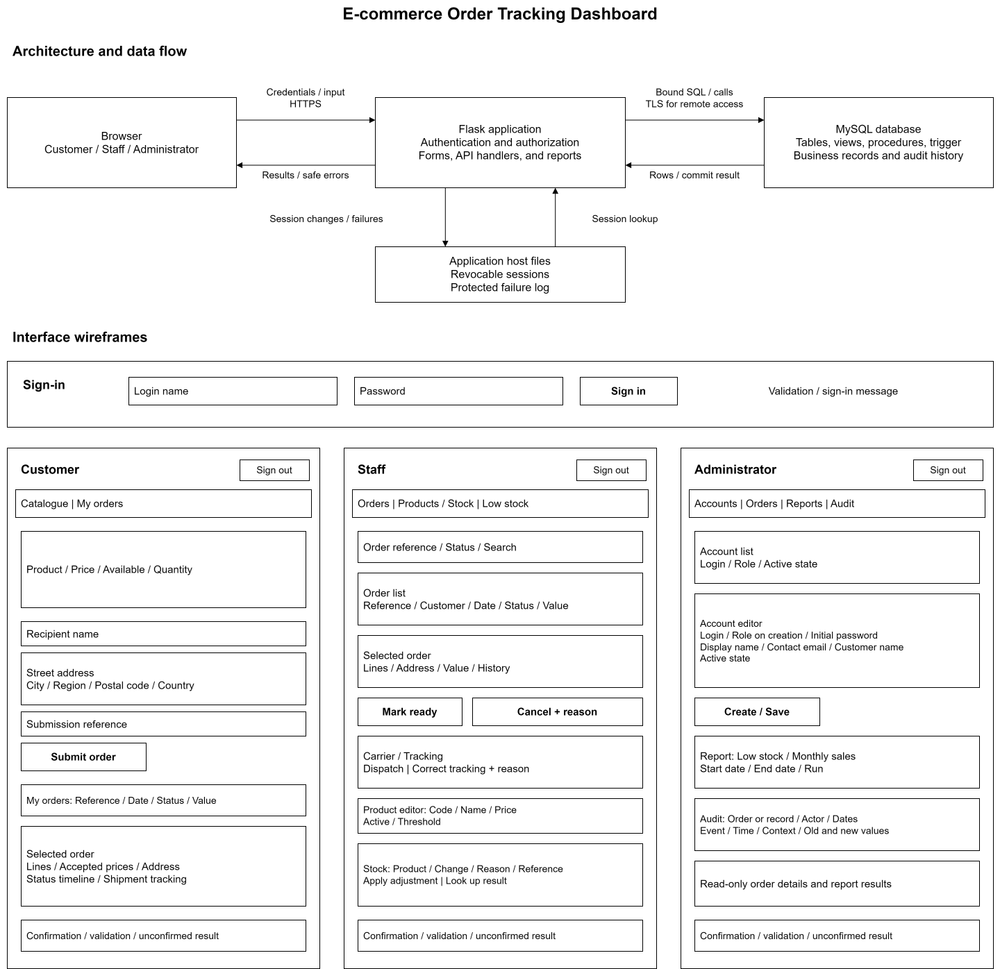

# Technical Design Document

## 1. Project identification

| Item | Information |
| --- | --- |
| Project title | E-commerce Order Tracking Dashboard |
| Prepared by | Bernardo Xie He & Henry Zhou |
| Course | 01:198:437:01 |
| Date | October 25, 2026 |
| Version | 1.3 |
| Requirements baseline | [FRD v1.7](FRD.md) |
| Repository | https://github.com/annberjin/E-commerce-tracking-dashboard |

## 2. Design overview

One web application and one MySQL database manage accounts, products, inventory, orders, shipments, and audit history using the ERD's ten business tables. Customers place and track their orders; staff manage stock and fulfillment; administrators maintain accounts and review reports. Database constraints and controlled procedures enforce the FRD. Each business operation commits with its successful audit records or rolls back completely.

## 3. Technical environment

| Component | Design target | Purpose |
| --- | --- | --- |
| Database | MySQL 8.4 with InnoDB | Relational storage, transactions, constraints, and SQL objects. |
| SQL tools | MySQL 8.4 `mysql` and `mysqldump` clients | Build, validation, backup, and restoration. |
| Application | Python 3.12, Flask 3.1, MySQL Connector/Python | One backend serving HTML pages and JSON endpoints; parameterized SQL calls. |
| Interface | HTML, CSS, and small JavaScript form handlers | Forms, order tracking, and tabular reports. |
| Authentication libraries | Werkzeug password helpers; Flask-Session with CacheLib file storage; Flask-WTF | Password hashes, revocable sessions, and CSRF protection. |
| Modeling | diagrams.net | Editable ERD and system design drawings. |
| Source and build | Git/GitHub, Bash, Python virtual environment | Versioned documents, ordered SQL build, and application dependencies. |
| Operating environment | Linux or Windows with WSL | Local development and demonstration. |

Pin application dependencies. Configuration supplies database connection settings, application secret, and session/log directories. Keep secrets outside Git.

Use `utf8mb4`, strict SQL mode including `STRICT_TRANS_TABLES` and `ONLY_FULL_GROUP_BY`, and UTC database connections. Use persistent database storage with `innodb_flush_log_at_trx_commit=1` and, when binary logging is enabled, `sync_binlog=1`. Business writes use explicit transactions; no business procedure performs DDL.

## 4. Architecture and scope

The browser calls one Flask application, which serves pages, checks authentication/permissions, and calls MySQL. MySQL stores business data and successful audits. Sessions and protected failure logs use local application files.

The system supports one retailer, one inventory location, USD prices, UTC event times, manually entered shipment information, and fictional demonstration data. Payments, carrier integration, returns, and refunds are outside scope.

### 4.1 Architecture, data flow, and wireframes

Editable source: [SystemDesign.drawio](SystemDesign.drawio).

The drawing shows application/database boundaries, request/result flows, and role-specific page layouts. All pages provide sign-out and operation/error messages. The backend enforces permissions and confirms success only after commit; unavailable data is not displayed as an empty result.

### 4.2 API design

All routes below use the authenticated session except sign-in. The backend derives the actor from the session; it never accepts a client-supplied actor or role as authorization. JSON amount values use decimal strings. Write requests require a CSRF token. Each route checks current active state and its listed role.

| Method and path | Access | Input and result |
| --- | --- | --- |
| `POST /api/session` | Sign-in | Login name and password; establish a session after verification. |
| `DELETE /api/session` | Signed-in user | Invalidate the server session and expire the cookie. |
| `GET /api/products` | All roles | Active product code/name, current price, stock availability; staff may request inactive products for maintenance. |
| `POST /api/products`; `PATCH /api/products/{id}` | Staff | Create product with threshold and zero stock; update name, price, threshold, or active state. |
| `POST /api/stock-adjustments` | Staff | Product, signed quantity change, reason, adjustment reference; return recorded before/after quantities. |
| `GET /api/stock-adjustments/{reference}` | Staff | Retrieve the initiating account's recorded adjustment result. |
| `POST /api/orders` | Customer | Submission reference, delivery fields, and product/quantity lines; return order reference, accepted value, and initial status. |
| `GET /api/orders`; `GET /api/orders/{id}` | Customer: owned; Staff/Administrator: all | RQ-01 list/detail; optional status filter. Customer submission-reference lookup is a scoped list filter. |
| `POST /api/orders/{id}/ready` | Staff | Mark a pending order ready. |
| `POST /api/orders/{id}/shipment` | Staff | Carrier and tracking number; create one shipment and mark shipped. |
| `POST /api/orders/{id}/cancellation` | Staff | Reason; cancel an eligible order and restore stock once. |
| `PATCH /api/orders/{id}/shipment` | Staff | Correct carrier/tracking with a reason. |
| `GET /api/accounts`; `POST /api/accounts`; `PATCH /api/accounts/{id}` | Administrator | List/create accounts; maintain display/contact/profile details and active state. Role and identifiers remain fixed. |
| `GET /api/reports/low-stock` | Staff/Administrator | RQ-02. |
| `GET /api/reports/monthly-sales` | Administrator | RQ-03 with UTC start/end dates. |
| `GET /api/audit` | Administrator | RQ-04 with record/order, actor, and UTC date filters. |

Successful reads and replays return 200; new records return 201. Invalid input returns 400, an invalid session 401, forbidden operations 403, and missing or unowned records 404. Reference or lifecycle conflicts return 409. Database unavailability or an unconfirmed commit returns 503 with a distinct `unavailable` or `unconfirmed` outcome and the original reference when available. Errors contain a safe message and context reference, without SQL details. List endpoints return bounded pages in the report's specified order.

## 5. Entity-relationship design

The ERD source, export, and explanation are [ERD.drawio](ERD.drawio), [ERD.svg](ERD.svg), and [ERD.md](ERD.md).

Entity purposes and attributes are specified in Section 7. The relationships are:

| Parent | Child | Children per parent | Parents per child |
| --- | --- | --- | --- |
| Role | UserAccount | 0..* | 1 |
| UserAccount | Customer | 0..1 | 1 |
| Customer | OrderHeader | 0..* | 1 |
| OrderStatus | OrderHeader | 0..* | 1 |
| OrderHeader | Shipment | 0..1 | 1 |
| OrderHeader | OrderLine | 1..* | 1 |
| Product | OrderLine | 0..* | 1 |
| Product | Inventory | 1 | 1 |
| UserAccount | AuditLog | 0..* | 1 |
| OrderHeader | AuditLog | 1..* | 0..1 |

`OrderLine` resolves the many-to-many relationship between orders and products. It is a weak entity identified by its parent order and the partial key `LineNumber`. `Role` and `OrderStatus` are fixed lookup tables. Shared parent keys identify `Customer`, `Inventory`, and `Shipment`. Every CUSTOMER account has one profile, every product has one inventory row, and every committed SHIPPED order has one shipment. Other accounts have no customer profile; other order statuses have no shipment.

## 6. Relational schema

**Role**(RoleCode, RoleName)

PK: (RoleCode).

**UserAccount**(AccountID, LoginName, DisplayName, ContactEmail, PasswordHash, RoleCode, IsActive)

PK: (AccountID). FK: RoleCode → Role.RoleCode. UQ: (LoginName).

**Customer**(CustomerID, CustomerName)

PK: (CustomerID). FK: CustomerID → UserAccount.AccountID.

**OrderStatus**(StatusCode, StatusName)

PK: (StatusCode).

**OrderHeader**(OrderID, CustomerID, SubmissionReference, SubmittedAt, StatusCode, RecipientName, StreetAddress, City, Region, PostalCode, Country, CancellationReason, CancelledAt)

PK: (OrderID). FK: CustomerID → Customer.CustomerID; StatusCode → OrderStatus.StatusCode. UQ: (CustomerID, SubmissionReference).

**Shipment**(OrderID, Carrier, TrackingNumber, DispatchedAt)

PK: (OrderID). FK: OrderID → OrderHeader.OrderID.

**OrderLine**(OrderID, LineNumber, ProductID, Quantity, AcceptedUnitPrice)

PK: (OrderID, LineNumber). FK: OrderID → OrderHeader.OrderID; ProductID → Product.ProductID. UQ: (OrderID, ProductID).

**Product**(ProductID, ProductCode, ProductName, CurrentUnitPrice, IsActive)

PK: (ProductID). UQ: (ProductCode).

**Inventory**(ProductID, AvailableQuantity, LowStockThreshold)

PK: (ProductID). FK: ProductID → Product.ProductID.

**AuditLog**(AuditID, ActorAccountID, EventType, OccurredAt, EntityName, RecordKey, FieldName, OldValue, NewValue, Reason, ContextReference, OrderID, AdjustmentReference)

PK: (AuditID). FK: ActorAccountID → UserAccount.AccountID; OrderID → OrderHeader.OrderID. UQ: (ActorAccountID, AdjustmentReference).

All foreign keys use restrictive update/delete behavior; identifiers remain fixed. There are no cascading deletes. Additional required-child conditions are enforced by the procedures, since an FK alone does not require a parent to have a child. The order reference displayed to users is `OrderHeader.OrderID`.

## 7. Table and attribute specifications

### 7.1 Storage conventions

PK means primary key, FK means foreign key, UQ means unique key, and UQ* marks a column in a composite unique key.

Use utf8mb4 text. LoginName and ProductCode are stored after trimming and compared using utf8mb4_0900_as_ci, which is case insensitive and accent sensitive. RoleCode, StatusCode, EventType, EntityName, FieldName, submission/adjustment references and RecordKey use utf8mb4_0900_bin for exact case sensitive comparison. Required text is trimmed and nonblank. Optional Region and reasons use NULL when absent. Reject values beyond the documented lengths rather than truncating them. Display names and contact emails are not unique.

All DATETIME(6) values are supplied in UTC by the controlled backend. BOOLEAN columns are restricted to 0 and 1. Prices use DECIMAL(10,2); reject input with more than two decimal places before assignment rather than relying on conversion rounding. Quantities use INT with the positive/nonnegative checks stated below. Defaults apply only where listed; otherwise the operation must supply the value.

### 7.2 Business tables

#### Role

One fixed application role.

| Column | MySQL type | Null? | Key | Default | Meaning / constraint |
| --- | --- | --- | --- | --- | --- |
| RoleCode | `VARCHAR(16)` | No | PK | None | CUSTOMER, STAFF or ADMINISTRATOR. |
| RoleName | `VARCHAR(40)` | No | — | None | Readable role name. |

Seed the three fixed codes. Runtime operations cannot add, edit or delete role definitions.

Requirements: FR-01, FR-02; BR-02.

#### UserAccount

One application identity and its current contact information.

| Column | MySQL type | Null? | Key | Default | Meaning / constraint |
| --- | --- | --- | --- | --- | --- |
| AccountID | `INT UNSIGNED` | No | PK | AUTO_INCREMENT | Permanent account identifier. |
| LoginName | `VARCHAR(100)` | No | UQ | None | Trimmed; case insensitive unique login. |
| DisplayName | `VARCHAR(100)` | No | — | None | Account display label; duplicates allowed. |
| ContactEmail | `VARCHAR(254)` | No | — | None | Current contact email; duplicates allowed. |
| PasswordHash | `VARCHAR(255)` | No | — | None | Encoded salted password hash; never plaintext. |
| RoleCode | `VARCHAR(16)` | No | FK | None | References Role.RoleCode; immutable after creation. |
| IsActive | `BOOLEAN` | No | — | TRUE | Only 0 or 1. |

Create the account and, for CUSTOMER only, its Customer row in one audited transaction. Recheck active state and role for protected operations. Signing out also invalidates the session in the application.

Requirements: FR-01, FR-02; BR-01, BR-02; SEC-01, SEC-04.

#### Customer

One customer profile, identified by its customer account.

| Column | MySQL type | Null? | Key | Default | Meaning / constraint |
| --- | --- | --- | --- | --- | --- |
| CustomerID | `INT UNSIGNED` | No | PK/FK | None | References UserAccount.AccountID; shared primary key. |
| CustomerName | `VARCHAR(100)` | No | — | None | Customer contact name, distinct from the account display label. |

Exactly one profile for every CUSTOMER account; none for STAFF or ADMINISTRATOR. Contact email is read from UserAccount.ContactEmail and stored only there.

Requirements: FR-02, FR-05; BR-02.

#### OrderStatus

One fixed order lifecycle status.

| Column | MySQL type | Null? | Key | Default | Meaning / constraint |
| --- | --- | --- | --- | --- | --- |
| StatusCode | `VARCHAR(16)` | No | PK | None | PENDING, READY_TO_SHIP, SHIPPED or CANCELLED. |
| StatusName | `VARCHAR(30)` | No | — | None | Readable status name. |

Seed the four fixed codes. Runtime operations cannot change the definitions. Valid codes alone do not enforce valid transitions.

Requirements: FR-08 through FR-11; BR-09.

#### OrderHeader

One accepted order with its delivery snapshot and current status.

| Column | MySQL type | Null? | Key | Default | Meaning / constraint |
| --- | --- | --- | --- | --- | --- |
| OrderID | `INT UNSIGNED` | No | PK | AUTO_INCREMENT | Permanent identifier; also the displayed order reference. |
| CustomerID | `INT UNSIGNED` | No | FK | None | References Customer.CustomerID. |
| SubmissionReference | `VARCHAR(64)` | No | UQ* | None | Unique together with CustomerID; case sensitive. |
| SubmittedAt | `DATETIME(6)` | No | — | None | UTC acceptance time supplied by the backend. |
| StatusCode | `VARCHAR(16)` | No | FK | 'PENDING' | References OrderStatus.StatusCode. |
| RecipientName | `VARCHAR(100)` | No | — | None | Accepted delivery recipient. |
| StreetAddress | `VARCHAR(255)` | No | — | None | Accepted street/address text. |
| City | `VARCHAR(100)` | No | — | None | Accepted city or locality. |
| Region | `VARCHAR(100)` | Yes | — | NULL | Optional state/region; absent value is NULL. |
| PostalCode | `VARCHAR(20)` | No | — | None | Text preserves leading zeros and letters. |
| Country | `VARCHAR(100)` | No | — | None | Accepted country name. |
| CancellationReason | `VARCHAR(255)` | Yes | — | NULL | Required only when status is CANCELLED. |
| CancelledAt | `DATETIME(6)` | Yes | — | NULL | UTC cancellation time; required only when CANCELLED. |

At least one OrderLine is required at commit. Customer, submission reference/time and delivery fields are immutable after acceptance. Cancellation fields are both NULL unless CANCELLED; then both are required and CancelledAt >= SubmittedAt. Order value is calculated from its lines.

Requirements: FR-05 through FR-10; BR-03, BR-08 through BR-12, BR-16, BR-18.

#### Shipment

The single dispatch record for an order.

| Column | MySQL type | Null? | Key | Default | Meaning / constraint |
| --- | --- | --- | --- | --- | --- |
| OrderID | `INT UNSIGNED` | No | PK/FK | None | References OrderHeader.OrderID; prevents a second shipment. |
| Carrier | `VARCHAR(80)` | No | — | None | Current carrier text. |
| TrackingNumber | `VARCHAR(100)` | No | — | None | Current tracking number; not globally unique. |
| DispatchedAt | `DATETIME(6)` | No | — | None | UTC dispatch time; immutable after dispatch. |

Create only for a READY_TO_SHIP order, and set SHIPPED in the same transaction. Dispatch is not earlier than acceptance or readiness. Later carrier/tracking corrections require a reason and audit values.

Requirements: FR-10, FR-11; BR-10, BR-13, BR-18.

#### OrderLine

One product and its accepted quantity and price within an order.

| Column | MySQL type | Null? | Key | Default | Meaning / constraint |
| --- | --- | --- | --- | --- | --- |
| OrderID | `INT UNSIGNED` | No | PK/FK | None | References OrderHeader.OrderID; first part of the key. |
| LineNumber | `INT UNSIGNED` | No | PK | None | Positive number meaningful only inside the order. |
| ProductID | `INT UNSIGNED` | No | FK/UQ* | None | References Product.ProductID; unique within the order. |
| Quantity | `INT` | No | — | None | Positive whole number. |
| AcceptedUnitPrice | `DECIMAL(10,2)` | No | — | None | Positive accepted USD unit price. |

Primary key is (OrderID, LineNumber). UNIQUE(OrderID, ProductID) separately prohibits duplicate product lines. Lines remain unchanged after acceptance, including cancellation. Product names are read from Product.ProductName.

Requirements: FR-05; BR-03 through BR-05, BR-08, BR-12.

#### Product

One catalogue product and its current name and price.

| Column | MySQL type | Null? | Key | Default | Meaning / constraint |
| --- | --- | --- | --- | --- | --- |
| ProductID | `INT UNSIGNED` | No | PK | AUTO_INCREMENT | Permanent product identifier. |
| ProductCode | `VARCHAR(40)` | No | UQ | None | Trimmed; case insensitive unique product code. |
| ProductName | `VARCHAR(150)` | No | — | None | Current name, including when shown on old orders. |
| CurrentUnitPrice | `DECIMAL(10,2)` | No | — | None | Positive current USD price. |
| IsActive | `BOOLEAN` | No | — | TRUE | Only 0 or 1; only active products can be ordered. |

Create Product and Inventory together. Product identifiers/codes are immutable. Deactivation preserves the product, inventory and existing order lines.

Requirements: FR-03, FR-05; BR-01, BR-04, BR-05, BR-14; RQ-01.

#### Inventory

The current available quantity and low-stock threshold for one product.

| Column | MySQL type | Null? | Key | Default | Meaning / constraint |
| --- | --- | --- | --- | --- | --- |
| ProductID | `INT UNSIGNED` | No | PK/FK | None | References Product.ProductID; shared primary key. |
| AvailableQuantity | `INT` | No | — | 0 | Nonnegative whole number. |
| LowStockThreshold | `INT` | No | — | None | Nonnegative whole number supplied when creating the product. |

Exactly one row per product. Acceptance reduces available quantity; eligible cancellation restores it once. Readiness, dispatch and tracking correction do not change it. Low stock means AvailableQuantity <= LowStockThreshold.

Requirements: FR-03, FR-04, FR-05, FR-09, FR-17; BR-06, BR-07, BR-19.

#### AuditLog

One recorded field change from a successful business operation.

| Column | MySQL type | Null? | Key | Default | Meaning / constraint |
| --- | --- | --- | --- | --- | --- |
| AuditID | `BIGINT UNSIGNED` | No | PK | AUTO_INCREMENT | Unique audit event identifier. |
| ActorAccountID | `INT UNSIGNED` | No | FK | None | References UserAccount.AccountID; supplied from authenticated identity. |
| EventType | `VARCHAR(40)` | No | — | None | Operation/event classification defined below. |
| OccurredAt | `DATETIME(6)` | No | — | None | UTC time of this event. |
| EntityName | `VARCHAR(32)` | No | — | None | Affected business table; validated allowlist. |
| RecordKey | `VARCHAR(100)` | No | — | None | Affected key; order lines use OrderID:LineNumber. |
| FieldName | `VARCHAR(64)` | No | — | None | Single changed field; validated for the target table. |
| OldValue | `TEXT` | Yes | — | NULL | Previous scalar value; NULL for creation/previous SQL NULL. |
| NewValue | `TEXT` | Yes | — | NULL | New scalar value; NULL if the new SQL value is NULL. |
| Reason | `VARCHAR(255)` | Yes | — | NULL | Required for adjustments, cancellations/restorations and tracking corrections. |
| ContextReference | `VARCHAR(64)` | No | — | None | Nonunique correlation reference for related events. |
| OrderID | `INT UNSIGNED` | Yes | FK | NULL | References OrderHeader.OrderID when the event belongs to an order. |
| AdjustmentReference | `VARCHAR(64)` | Yes | UQ* | NULL | Only for STOCK_ADJUSTED; unique with ActorAccountID. |

Append successful changes in the same transaction as business writes. Runtime access cannot update or delete audit rows. Failed attempts and unknown actors go to the separate protected failure log described in FRD 9.2, not to this successful-event relation.

Requirements: FR-04, FR-12 through FR-15; BR-15, BR-16; SEC-05, SEC-06; RQ-04.

## 8. Normalization analysis

| Normal form | Evidence |
| --- | --- |
| 1NF | One product per OrderLine; address components occupy separate fields; each audit row contains one field change. No lists of product IDs or repeating line columns. |
| 2NF | Quantity and AcceptedUnitPrice depend on the complete OrderLine key `(OrderID, LineNumber)`. Current product facts remain in Product. Other tables use a single-column PK. |
| 3NF | RoleName depends on RoleCode in Role; StatusName depends on StatusCode in OrderStatus. ContactEmail belongs only to UserAccount. Current product name/price and stock facts remain in their own relations. Header delivery fields describe the accepted order, not the customer's current profile. |

Each primary or alternate key in Section 6 determines its row. ContextReference is nonunique. Accepted prices, delivery snapshots, and prior/new audit values preserve historical facts. CustomerName is a contact name; DisplayName is an account label. Derived order values and reporting joins are defined in Sections 10–11.

## 9. Integrity, validation, and business-rule enforcement

### 9.1 Rule mapping

| FRD rule | Enforcement | Verification |
| --- | --- | --- |
| BR-01 | PK/FK/UNIQUE/NOT NULL; trimmed nonblank text; fixed identifiers and ownership; specified collations. | T-01 through T-05, T-09. |
| BR-02 | Fixed roles; account/profile creation procedure; current active state and role checks. | T-06 through T-09. |
| BR-03 | Positive quantities/line numbers; order-line PK and product UQ; at least one line before commit. | T-10 through T-13. |
| BR-04, BR-05 | Lock product and stock rows; validate activity/quantity; copy the stored current price; exact decimal calculations. | T-11, T-14, T-15, T-18. |
| BR-06, BR-07 | Nonnegative inventory CHECK; zero initial stock; controlled signed adjustment, acceptance, and cancellation. | T-16 through T-18, T-23, T-26. |
| BR-08, BR-15 | One transaction per operation; exception handler rolls back every business and successful-audit write. | T-19, T-20, T-32. |
| BR-09, BR-10 | Lock OrderHeader; permitted transitions only; Shipment PK/FK; dispatch procedure and update trigger. | T-21 through T-25. |
| BR-11 | Staff cancellation from PENDING/READY_TO_SHIP only; no shipment; required reason; stock restoration and status change together. | T-26 through T-28. |
| BR-12 through BR-14 | Runtime executes fixed procedures; no direct table writes; immutable accepted facts and audit rows; deactivation instead of deletion. | T-15, T-29 through T-31. |
| BR-16 | Scoped reference UQs; account lock, stored-content comparison, and original-result replay. | T-33 through T-36. |
| BR-17 | Account/order/product/inventory row locks; current validation; full rollback on deadlock/lock timeout. | T-37 through T-39. |
| BR-18 | UTC times; cancellation CHECK; dispatch/readiness comparison; inclusive date filtering. | T-25, T-41. |
| BR-19, BR-20 | Reporting views and queries use threshold comparison and shipped order values grouped by dispatch month. | T-40 through T-42. |
| BR-21 | Confirm commit before success; resolve saved results under the same serialization locks before retrying. | T-43, T-44. |

Implement the column and cancellation constraints in Section 7 with PK, FK, UNIQUE, NOT NULL, and CHECK. Conditional CHECKs explicitly test NULL. AdjustmentReference is non-NULL exactly for STOCK_ADJUSTED; adjustment, cancellation/restoration, and tracking-correction events require reasons. Procedures enforce required children and shipment/status agreement because [MySQL CHECK constraints](https://dev.mysql.com/doc/refman/8.4/en/create-table-check-constraints.html) cannot query other tables.

### 9.2 Transaction boundaries

Public write procedures own `START TRANSACTION` and `COMMIT`; their `EXIT HANDLER FOR SQLEXCEPTION` executes `ROLLBACK; RESIGNAL;`. Call them without an outer transaction and consume their result sets before connection reuse. Helpers never commit. Validation failures use `SIGNAL SQLSTATE '45000'`, mapped to safe API errors. Return success only after commit.

| Operation | Work committed together |
| --- | --- |
| Create/update account | Account changes, required CUSTOMER profile, and relevant nonsecret audit fields. |
| Create/update product | Product changes, the inventory row/threshold, and audit fields; new quantity is zero. |
| Adjust stock | Validate reference and signed change; update quantity; insert exactly one STOCK_ADJUSTED row containing the recorded before/after result. |
| Place order | Validate every line; create header/lines with accepted prices and address; deduct stock; record acceptance, line, and stock audits. |
| Mark ready | Validate PENDING; set READY_TO_SHIP and append the status audit. |
| Dispatch | Validate READY_TO_SHIP and no shipment; insert Shipment; trigger sets SHIPPED; append shipment and status audits. This is separate from readiness. |
| Cancel | Validate PENDING/READY_TO_SHIP and no shipment; restore each line quantity; set cancellation fields/status; append stock/status audits. Lines remain unchanged. |
| Correct tracking | Validate SHIPPED, reason, and changed values; update carrier/tracking and audit old/new values. Dispatch time remains fixed. |

### 9.3 Concurrency

Writes use READ COMMITTED and current [SELECT ... FOR UPDATE](https://dev.mysql.com/doc/refman/8.4/en/innodb-locking-reads.html) reads; stock-adjustment replay reads use FOR SHARE on immutable AuditLog rows. Lock required existing UserAccount rows in AccountID order, including the actor, and recheck active state/role. Next lock the affected existing order, then Product and Inventory one product at a time in ProductID order, always Product before Inventory. Hold locks until commit/rollback; product maintenance follows the same order.

Validate activity, price, and stock under these locks; update stock arithmetically from its current value. The order lock serializes dispatch/cancellation; the account lock orders deactivation against protected writes. Deadlocks/timeouts roll back the entire operation. Retry only after confirmed rollback, using the same reference and fresh validation. Do not wait for user input or external responses while holding locks. Multi-query order details use a read-only REPEATABLE READ transaction.

### 9.4 Reference reuse and uncertain results

`(CustomerID, SubmissionReference)` identifies an accepted order. Compare product/quantity pairs as a set and the stored delivery fields; ignore later catalogue changes. A matching replay returns OrderID, accepted value, and initial PENDING status. Current status remains available separately.

`(ActorAccountID, AdjustmentReference)` identifies exactly one STOCK_ADJUSTED row. Other audit events have NULL AdjustmentReference. Compare product, reason, and signed change derived from validated NewValue minus OldValue. A matching replay returns the saved before/after quantities. Changed content for either reference produces a conflict while preserving access to the original result; replays add no business changes or successful mutation audits.

Retain the original reference/content after a lost response. Acquire the initiating account lock and perform a current locking reference lookup before retrying. This waits for any earlier operation to commit or roll back. A still-absent result then permits a validated retry. An independent not-found lookup does not prove failure; unavailable storage or an unobtainable lock leaves the result unresolved with no new changes.

Resolve other operations from the affected record and audit context under the same account/order locks. Keep an indeterminate outcome unconfirmed; never repeat a terminal transition, stock restoration, or shipment.

### 9.5 Audit design

AuditLog stores one scalar field change per row. EntityName permits UserAccount, Customer, Product, Inventory, OrderHeader, OrderLine, or Shipment. RecordKey is the decimal identifier, or `OrderID:LineNumber`. The private writer validates the event, target, field, and linkage; this target is not an FK. ActorAccountID and optional OrderID are FKs, and every order-related event carries OrderID. Values use decimal integers, two-place prices, 0/1 booleans, UTC timestamps, or stored text. Exclude credentials and session secrets.

| Event types | Required representation |
| --- | --- |
| CREATE, UPDATE, ACTIVATE, DEACTIVATE | One row for each relevant changed nonsecret field; old value is NULL on creation. Product/inventory and account/profile creation are audited together. |
| ORDER_ACCEPTED, ORDER_READY, ORDER_SHIPPED, ORDER_CANCELLED | One OrderHeader.StatusCode change per transition. Acceptance also records the accepted order/line fields. The customer timeline selects only the header status rows and their times. |
| STOCK_DEDUCTED, STOCK_RESTORED | Inventory.AvailableQuantity before/after values, linked to the order. Restoration carries the cancellation reason. |
| STOCK_ADJUSTED | Exactly one Inventory.AvailableQuantity row, with product key, actor, adjustment reference, reason and before/after quantities. |
| TRACKING_CORRECTED | Changed Shipment.Carrier and/or TrackingNumber fields with the correction reason. |

Pass one backend-generated UUID context to related writes; ContextReference is nonunique and groups events. Successful audits are append-only and commit with the business operation. After rollback, record failures in a protected file when available: actor or `unknown`, UTC time, operation/context, safe error category, and failed/unconfirmed outcome.

## 10. Database objects and SQL design

### 10.1 Required objects

| Object | Purpose and inputs | Requirements |
| --- | --- | --- |
| `sp_create_account`, `sp_update_account` | Administrator actor, account/profile data, password hash on creation, context; create fixed-role account or update allowed fields. | FR-02. |
| `sp_create_product`, `sp_update_product` | Staff actor, product fields, threshold, context; create product/inventory or update allowed fields. | FR-03. |
| `sp_adjust_stock` | Staff actor, product, signed change, reason, adjustment reference, context; return original or new before/after result. | FR-04, FR-13. |
| `sp_place_order` | Customer actor, submission reference, delivery fields, JSON array of product/quantity lines, context; return accepted order result. The JSON is input only, not a stored column. | FR-05, FR-12, FR-13. |
| `sp_mark_ready`, `sp_dispatch_order`, `sp_cancel_order`, `sp_correct_tracking` | Staff actor, order, operation-specific fields/reason, context; enforce Section 9.2. | FR-08 through FR-11. |
| `sp_append_audit` | Private helper; validate and insert one nonsecret scalar field change using the fields in Section 7. | FR-14. |
| `trg_shipment_after_insert` | Update the parent OrderHeader from READY_TO_SHIP to SHIPPED when a valid shipment is inserted. | FR-10; C-04. |
| `v_order_value` | One row per order: OrderID and SUM(Quantity × AcceptedUnitPrice). | FR-06, FR-07, FR-16. |
| `v_order_summary` | Join header, customer, current status, order value, and optional shipment for lists/tracking. No audit join that multiplies rows. | RQ-01. |
| `v_low_stock` | Join active Product and Inventory with AvailableQuantity <= LowStockThreshold. | RQ-02. |
| `v_shipped_order_value` | One row per SHIPPED order with its dispatch time and calculated merchandise value. | RQ-03. |

Order input line numbers are assigned from the submitted line sequence; locking uses ProductID order independently. Validate the JSON array structure and each product/quantity before writing.

The procedures recheck role and active state from UserAccount; the actor argument is supplied only by the authenticated backend. The application uses parameter binding for every input. Views are read-only report sources in the application; they do not themselves establish customer ownership. The customer query includes `CustomerID = authenticated AccountID`.

After header locking and readiness/time validation, dispatch inserts Shipment using `VALUES`. Its [AFTER INSERT trigger](https://dev.mysql.com/doc/refman/8.4/en/trigger-syntax.html) changes exactly one eligible READY_TO_SHIP header to SHIPPED or raises an error. The procedure writes shipment/status audits and does not repeat the update. Any failure rolls back the shipment, trigger update, and audits together.

### 10.2 Index design

Primary and unique keys provide the indexes stated in Section 6. Each foreign key has an index with the FK columns as its leftmost columns; reuse an existing suitable index instead of creating a duplicate.

| Table | Index columns | Use |
| --- | --- | --- |
| OrderHeader | (CustomerID, SubmittedAt, OrderID) | Customer order history and its sort order. |
| OrderHeader | (StatusCode, SubmittedAt, OrderID) | Staff status-filtered orders. |
| Shipment | (DispatchedAt, OrderID) | Monthly shipped-sales date selection. |
| AuditLog | (OrderID, OccurredAt, AuditID) | Ordered lifecycle and order audit history. |
| AuditLog | (EntityName, RecordKey, OccurredAt, AuditID) | History for another affected record. |

Indexes add storage and write cost. Use EXPLAIN and measured report queries to justify additions.

### 10.3 Build and initialization

Use `build/`, `database/`, and `docs/`. The ordered `database/manifest.txt` creates the database and MySQL identities/role, reference/core/relationship tables and constraints, views/procedures/trigger, grants, seed data, then validation. An operational BuildLog records script attempts, tag, commit SHA, start/end times, outcome, and sanitized errors; retain file logs when database logging fails.

`build/build_database.sh` validates tools, configuration, connectivity, the exact Git tag, and manifest entries before creating the target. Reject unsafe, missing, duplicate, or misordered entries; stop on script/validation failure. Record the resolved commit. Require explicit confirmation before replacing an existing database. Do not use `--force` or assume DDL can roll back the entire build.

Seed the three roles and four statuses before fictional accounts/products/orders. A local setup command provisions the first administrator from a hidden prompt or environment-supplied password, storing only its hash. Keep default passwords out of Git. Seed business workflows retain successful audits and a bootstrap context.

Validate objects, keys/constraints, lookups, seed counts, required children, orphan checks, shipment/status agreement, and report results. Preserve execution order, timestamps, errors, and validation output in the build evidence.

## 11. Query and report design

All reports use the FRD's role rules. UTC date filters use `timestamp >= start_date` and `timestamp < end_date + INTERVAL 1 DAY`, including the entire final day without wrapping indexed timestamp columns in a function. Reject reversed or invalid dates. Amounts display as USD with two decimal places.

| Query | Tables/view and SQL features | Output and order |
| --- | --- | --- |
| RQ-01 | v_order_summary; detail joins OrderLine/Product and optional Shipment; scoped parameterized filters; status events from AuditLog. | Order reference, submitted time, status, value; customer reference/name for staff/admin only. Sort SubmittedAt DESC, OrderID DESC. Detail lines sort LineNumber; timeline sorts OccurredAt, AuditID. Display current product name with accepted quantities/prices and accepted address. |
| RQ-02 | v_low_stock; Product/Inventory JOIN and threshold WHERE. | Active code/name, available quantity, threshold. Sort AvailableQuantity ASC, ProductCode ASC. |
| RQ-03 | v_shipped_order_value; date filter, GROUP BY dispatch year/month, COUNT and SUM. | One count/value per month in ascending month order; each order appears once. Unshipped/cancelled orders excluded. Empty range returns no month rows and overall count/value zero. |
| RQ-04 | AuditLog joined to UserAccount; OrderID filter includes stock/shipment events; otherwise EntityName/RecordKey; optional actor/date filters. | Event, actor, UTC time, context, reason and prior/new values, sorted OccurredAt ASC, AuditID ASC. |

The line aggregation occurs before any join to audit history, so multiple lines or events cannot inflate sales counts or values. The customer timeline selects only OrderHeader.StatusCode events and omits actor/reason fields. Order-reference and submission-reference lookups apply the same ownership filter.

The validation query for missing required children uses `NOT EXISTS`, such as finding an OrderHeader with no OrderLine.

### 11.1 Performance and growth

| Workload | Design and evidence |
| --- | --- |
| Reads | Bound list pages; use stable sort keys and indexed filters. Capture EXPLAIN for customer history, staff status filters, monthly sales, and order audit history. |
| Updates and deletes | Use keyed row updates in short transactions. Use cancellation/deactivation for business history; runtime deletion is denied. Authorized fixture cleanup occurs only in a disposable test database. |
| Large batches | Process sample-data loads in bounded committed batches. Each business order and its audits remain one indivisible transaction. Report counts and elapsed time. |
| High transaction volume | Exercise simultaneous requests using separate connections, especially the same stock row and order. Measure throughput, lock waits, deadlocks, and final invariants; avoid holding locks during page rendering. |
| Large extracts | Apply authorization/date limits, stream or page results, and use a consistent read snapshot when an extract must represent one point in time. Measure returned rows, elapsed time, and memory use. |

Accommodate growth by tuning measured queries, indexes, page sizes, and host resources.

## 12. Security, privacy, and backup assumptions

### 12.1 Permissions and database access

| Capability | Customer | Staff | Administrator |
| --- | --- | --- | --- |
| Active catalogue | Read | Read | Read |
| Submit order / read orders | Submit and read own | Read all | Read all |
| Product/stock maintenance | None | Allowed | None |
| Ready, dispatch, cancel, correct tracking | None | Allowed under lifecycle rules | None |
| Account/profile maintenance | None | None | Allowed |
| Low stock | None | Read | Read |
| Sales and complete audit reports | None | None | Read |
| Delete business history or update/delete audit rows | None | None | None |

The database account used by the backend receives a role `app_runtime` with required SELECT privileges and EXECUTE on the public procedures only. It has no direct INSERT/UPDATE/DELETE, DDL, grant privileges, or EXECUTE on the private audit helper. Write procedures and the trigger use a dedicated SQL SECURITY DEFINER identity with only the table/column privileges they require; its interactive login is locked. Build credentials are separate and are never used by the running application.

Application CUSTOMER/STAFF/ADMINISTRATOR roles are stored in UserAccount. The backend enforces the matrix and ownership for every request; procedures independently validate the supplied actor's current role/status. Clients cannot submit SQL or call procedures directly. The application administrator has no database-administrator privileges. Finalized data can change only through the permitted procedure fields and transitions.

### 12.2 Authentication and request protection

Use Werkzeug salted `scrypt` hashes; never return or audit PasswordHash. Flask-Session/CacheLib stores sessions in a private directory outside the web root. Rotate IDs on sign-in, delete server session data on sign-out, and recheck account activity/role on protected requests. Old signed-out cookies must fail.

Use HttpOnly/SameSite=Lax cookies, Secure for HTTPS, Flask-WTF CSRFProtect for modifying requests, output escaping, bound SQL parameters, and input length/range/precision/field validation. Use HTTPS and verified MySQL TLS for non-local connections. Restrict credentials, session files, logs, keys, and backups. Use fictional data; logs exclude passwords/hashes, cookies/tokens, connection strings, and full addresses.

### 12.3 Backup and recovery

Create a timestamped InnoDB backup with [mysqldump](https://dev.mysql.com/doc/refman/8.4/en/mysqldump.html) using `--single-transaction --routines --triggers`, including schema/data, views, routines, and triggers. Avoid concurrent DDL. Keep a restricted copy separately and preserve the build version and grants/definer configuration; a schema dump does not recreate MySQL accounts.

Restore into a separate empty database with the required MySQL identities, grants, locally supplied secrets, and definer settings. Verify objects, row counts, relationships/required children, audit history, permissions, and smoke tests. Record backup time, restore duration, and results. Recovery reaches the backup timestamp; later changes may be lost.

Crash tests use intact persistent storage and Section 3's durability settings. Check that committed records/audits survive and incomplete work disappears. Test session termination separately from a server crash; resolve uncertain results under Section 9.4.

## 13. Test plan and acceptance criteria

Use a disposable database with fictional accounts for each role, including two customers/staff, active/inactive products, boundary stock levels, all order statuses, and dispatches at date/month boundaries. The $55 order contains two $20 units and one $15 unit; another shipped order worth $40 gives $95 total.

Database and build checks have been executed; results are in `docs/evidence/database-verification.txt`. Application security, server crash recovery, backup restoration, and larger performance tests remain pending. Record setup, SQL/HTTP action, expected/actual result, pass/fail, and query/log evidence for every test and parameter variant. Use an isolated identity for constraint tests and the actual runtime identity for permission tests. Inject failures only in the disposable environment.

| Test | FRD acceptance | Action | Expected result |
| --- | --- | --- | --- |
| T-01 | AC-01, AC-15 | Insert a duplicate primary key. | PK violation; existing row unchanged. |
| T-02 | AC-01, AC-15 | Insert a row with a missing FK parent. | FK violation; no orphan. |
| T-03 | AC-01, AC-02 | Reuse a login/product code with case and surrounding-space variations. | Duplicate rejected after normalization. |
| T-04 | AC-01, AC-15 | Supply NULL and, separately, blank required text. | Each invalid input rejected. |
| T-05 | AC-02, AC-15 | Supply invalid boolean/domain values and overlength text. | Each rejected without truncation or partial changes. |
| T-06 | AC-01 | Administrator creates one account for each role. | CUSTOMER has one profile; other roles have none; changes audited. |
| T-07 | AC-01, AC-11 | Attempt invalid-password sign-in and an unlisted role operation. | Each denied with safe error and protected failure entry. |
| T-08 | AC-01, AC-11 | Deactivate an account; separately sign out and replay its previous cookie. | Next protected request denied in each case. |
| T-09 | AC-01, AC-09 | Attempt to change role, identifiers, or customer ownership. | Rejected; original links retained. |
| T-10 | AC-03 | Submit the $55 fixture order. | One PENDING order, correct lines/value, stock deducted once, audits present. |
| T-11 | AC-02, AC-03 | Submit zero/negative/fractional quantities; zero/negative or overprecision prices. | Each invalid value rejected. |
| T-12 | AC-03 | Submit an order with no lines. | Entire request rejected. |
| T-13 | AC-03 | Repeat a product in two order lines. | Entire request rejected; no stock effect. |
| T-14 | AC-03 | Include an inactive or insufficient-stock product among valid lines. | Entire order rejected, including its otherwise valid lines. |
| T-15 | AC-03, AC-04 | Change current product name/price and customer details after acceptance. | Current name displayed; accepted price, quantity, and delivery details unchanged. |
| T-16 | AC-02 | Create a product with a valid threshold. | Exactly one inventory row with quantity zero; creation audited. |
| T-17 | AC-02 | Apply a valid positive and a valid negative adjustment. | Correct before/after values, reference and reason retained per operation. |
| T-18 | AC-02 | Adjust to exactly zero; separately attempt negative result, zero change, or missing reason. | Zero result accepted; each invalid case rejected. |
| T-19 | AC-07 | Force a write failure after an order header/stock change but before commit. | Header, lines, stock changes and successful audits all rolled back. |
| T-20 | AC-07 | Force required audit insertion to fail. | Entire associated business operation rolled back. |
| T-21 | AC-05 | Mark a pending order ready. | READY_TO_SHIP and status audit committed; no stock change. |
| T-22 | AC-05 | Attempt skipped/backward/terminal transitions or an unknown status. | Each rejected without state changes. |
| T-23 | AC-05, AC-15 | Dispatch a ready order with valid shipment details. | One Shipment; trigger updates header to SHIPPED; no stock deduction; audits present. |
| T-24 | AC-05 | Fail dispatch after readiness committed; separately attempt missing tracking or a second shipment. | Readiness retained on failed dispatch; no partial shipment/status/audits; invalid duplicates rejected. |
| T-25 | AC-05 | Supply a dispatch timestamp earlier than readiness in a controlled database test. | Rejected; no shipment or status update. |
| T-26 | AC-06 | Cancel an eligible order with a reason. | Header CANCELLED; stock restored once; lines retained; audits present. |
| T-27 | AC-06 | Cancel the same order again. | No additional stock or audit mutation. |
| T-28 | AC-06 | Cancel a shipped order, omit reason, or use an unauthorized role. | Each denied without changes. |
| T-29 | AC-05 | Correct shipped tracking with a reason. | Only requested carrier/tracking fields change; dispatch time fixed; prior/new values audited. |
| T-30 | AC-04, AC-11 | Customer requests another customer's order, shipment, or submission result. | No other-customer data; own timeline omits actor/reason. |
| T-31 | AC-09, AC-11 | Runtime/admin role attempts direct writes, history deletion, or audit modification. | Denied by grants or controlled operation rules. |
| T-32 | AC-07, AC-15 | Kill a database session after uncommitted business and audit writes. | Its full transaction rolls back; earlier committed data remains. |
| T-33 | AC-08 | Replay a committed order and adjustment with identical content. | Original results returned; no new records, stock changes, or successful mutation audits. |
| T-34 | AC-08 | Reuse either reference with changed content. | Conflict; original result remains accessible to its owner. |
| T-35 | AC-08 | Different customers/staff use the same reference text. | Independent scoped results; no cross-account disclosure. |
| T-36 | AC-08 | Retry a fully rolled-back request using its original reference. | One valid new result after revalidation. |
| T-37 | AC-08 | Two customers compete for the last unit. | Exactly one success; final stock zero. |
| T-38 | AC-08 | Concurrent stock adjustments; inject a lock timeout/deadlock in a separate case. | No lost committed change; failed transaction fully rolled back. |
| T-39 | AC-08 | Race dispatch against cancellation; separately race two dispatches. | One permitted terminal outcome and at most one shipment. |
| T-40 | AC-10 | Threshold 3 with stock 2, 3, and 4, including an inactive product. | Only active quantities 2 and 3 appear, correctly ordered. |
| T-41 | AC-10 | Query $55/$40 shipped orders at date/month boundaries; include unshipped/cancelled controls. | Two shipped orders total $95 in correct UTC groups; inclusive final day; controls excluded. |
| T-42 | AC-10 | Query empty reports and an invalid date range. | Defined empty/zero output; reversed range rejected. |
| T-43 | AC-12 | Lose the commit response while the original transaction is still resolving; retry same reference. | Unconfirmed first response; serialization yields one committed result or safe retry, never duplicates. |
| T-44 | AC-12 | Stop the database abruptly with committed and incomplete transactions; restart on intact storage. | Committed rows/audits survive; incomplete effects absent; outage shown as unavailable. |
| T-45 | AC-13 | Backup and restore to an empty database; run data/access checks. | Data, objects, relationships, audit history and access controls restored to the recorded backup point. |
| T-46 | AC-11 | Submit SQL-like text and missing/invalid CSRF tokens to direct endpoints. | Text cannot change SQL structure; invalid CSRF requests rejected. |
| T-47 | AC-14 | Build from a selected valid tag into a fresh database. | Recorded tag/commit/order, required objects/data, and passing validation. |
| T-48 | AC-14 | Exercise each prerequisite/tag/manifest/connectivity/script/validation failure and unapproved database replacement. | Build stops safely; usable sanitized failure log; existing target protected. |
| T-49 | AC-09 | Query an order audit including stock/shipment events; filter another record, actor, and dates. | Complete correctly ordered matching events; no secret values. |
| T-50 | AC-15 | Run indexed reports on larger reproducible fixtures and exercise batch/concurrent/extract workloads. | Correct results; recorded row counts, plans, timings, and justified index choices. |
| T-51 | AC-11, AC-15 | Complete each permitted workflow through its role's page and direct endpoint. | Matching permissions/validation/results; denied roles cannot bypass the UI. |

## 14. Requirement traceability

| Requirement | Main data/objects | Enforcement/design | Test evidence |
| --- | --- | --- | --- |
| FR-01 | UserAccount, Role | Session, active/role checks; Section 12. | T-07 through T-09, T-30, T-46. |
| FR-02 | UserAccount, Customer, account procedures, AuditLog | Fixed role; shared profile key; audited atomic changes. | T-03 through T-09. |
| FR-03 | Product, Inventory, product procedures | Unique code; valid prices; one inventory row; deactivation. | T-03, T-05, T-15, T-16. |
| FR-04 | Inventory, AuditLog, sp_adjust_stock | Locked signed change; reason; scoped reference/result. | T-17, T-18, T-33 through T-38. |
| FR-05 | OrderHeader, OrderLine, Product, Inventory, sp_place_order | Accepted snapshots; stock validation; complete audited transaction. | T-10 through T-15, T-19. |
| FR-06, FR-07 | v_order_summary, OrderLine, Shipment, AuditLog | RQ-01; ownership and role filters. | T-15, T-30, T-51. |
| FR-08 | OrderHeader, AuditLog, sp_mark_ready | Locked PENDING to READY_TO_SHIP. | T-21, T-22. |
| FR-09 | OrderHeader, OrderLine, Inventory, sp_cancel_order | One restoration and terminal cancellation. | T-26 through T-28, T-39. |
| FR-10 | Shipment, OrderHeader, sp_dispatch_order, update trigger | Unique shipment and atomic SHIPPED transition. | T-23 through T-25, T-39. |
| FR-11 | Shipment, AuditLog, sp_correct_tracking | Allowed fields only; reason; immutable dispatch time. | T-29. |
| FR-12 | All write procedures and InnoDB tables | Exception rollback including successful audits. | T-19, T-20, T-24, T-32. |
| FR-13 | Scoped UQs, row locks, procedure reference checks | Replay/content conflict; serialization. | T-33 through T-39, T-43. |
| FR-14 | AuditLog, private audit writer | Required field events; actor/context/time; atomic append. | T-06, T-10, T-16, T-17, T-20, T-49. |
| FR-15 | AuditLog, UserAccount, RQ-04 | Administrator-only history and filters. | T-31, T-49. |
| FR-16 | v_order_value, v_shipped_order_value, RQ-03 | One order value before monthly aggregation. | T-41, T-42. |
| FR-17 | v_low_stock, RQ-02 | Active products at/below threshold. | T-40, T-42. |
| FR-18 | Flask routes, page forms/reports | Section 4; consistent safe API/UI results. | T-07, T-08, T-30, T-46, T-51. |
| FR-19, FR-20 | InnoDB durability, locks, saved references/history | Crash recovery; availability and uncertain-result handling. | T-32, T-43, T-44. |
| FR-21 | Backup/restore process and grants | Section 12.3; separate protected copy and verification. | T-45. |
| SEC-01 through SEC-03 | Sessions, UserAccount, procedures/scoped queries | Current identity, role, active state, and ownership. | T-06 through T-09, T-28, T-30, T-51. |
| SEC-04, SEC-05 | Password library, TLS, runtime/definer grants | Protected secrets/sessions; restricted writes/history. | T-08, T-31, T-45, T-51; inspect hashes, cookies, TLS and grants. |
| SEC-06, SEC-07 | Failure log, validation, bound parameters, CSRF | Safe errors and protected input handling. | T-07, T-19, T-44, T-46. |
| C-01 through C-03 | README, docs, scripts, manifest and release tag | Section 3 and Section 10.3. | T-47, T-48; compare documented versions and schema/ERD. |
| C-04, C-05 | Trigger, reports, indexes, architecture/API/wireframes | Sections 4, 8, 10 and 11. | T-23, T-32, T-50, T-51; inspect SQL feature and diagram coverage. |

The final demonstration uses the same test IDs and saves its executed SQL/HTTP actions, query results, build logs, and performance plans under `docs/evidence/`.
